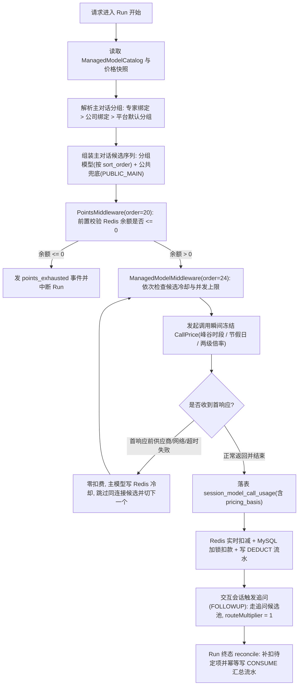

# KuaiBuddy 受管模型分组路由与积分计费机制说明

> 本文档基于 `/Users/linjt/Documents/kst-projects/kuaibuddy-projects/` 各仓库 `origin/dev1.13` 分支源码（`base@edc3452`、`service-agent@94f936a8`、`web-agent@014a1b7`）与 `2026-11-27` 测试环境（`kuaibuddy-tkf` 业务库、`nacos-kuaibuddy-tkf` 配置中心、Langfuse 与 ELK）实测对账结果整理。仅记录代码中可验证的机制与实测事实，不替代正式产品需求。

---

## 1. 总览与特性开关

KuaiBuddy 在 `dev1.13` 引入了**受管模型目录、分组路由与峰谷计费体系**，由配置开关 `kuaibuddy.model-management.enabled` 控制：

- **开启（`true`，测试环境 `service-agent.yaml` 当前已开启）**：由 `ManagedModelRoutingService` 装配路由快照 `RouteSnapshot`，主对话、追问建议与识图工具按数据库维护的模型目录、分组优先级、峰谷时段和两级倍率执行选路与计费；
- **关闭（`false`，默认兜底）**：回退旧 Nacos 配置链路，使用 `ModelSelector.select()` + `AgentFactory` 旧 `fallbackModel` + `PointsProperties` 静态价格表。

### 核心仓库职责划分

| 仓库 | 核心类与职责 |
|---|---|
| `base` | 目录与价格领域模型（`ManagedModelCatalog`）、5 张关系表读写与事务锁（`ManagedModelStore`）、基础计费公式（`PointsCalculator`）、Dubbo 注册契约（`ModelRegistryService`） |
| `service-agent` | 路由快照构建（`ManagedModelRoutingService`）、调用级容灾中间件（`ManagedModelMiddleware` / `ManagedModelCall`）、识图/追问候选池解析（`DimensionRouting`）、积分余额拦截与结算对账（`PointsMiddleware` / `PointsSettlementServiceImpl` / `PointsUsageCalculator`） |
| `web-agent` | 平台管理后台接口（`PlatformModelAdminController`）、目录/连接/分组/绑定业务校验（`ModelManagementService`）、成本价目同步发布（`ModelCostPublication`） |

### 端到端路由与计费流程



---

## 2. 数据模型、复合身份与存储结构

### 2.1 复合身份（`ModelRef`）

模型在目录中不再仅靠模型名识别，而是以 **`(provider, modelName)` 复合身份**作为唯一键（`ManagedModelCatalog.ModelRef`）：

- 内部拼接键格式为 `provider + "\u001f" + modelName`（不可显示分隔符）；
- 当 `provider` 为空字符串（如管理界面“请选择”）时，内部键直接为 `modelName`；
- 相同 `modelName` 但不同 `provider` 的模型在成本、连接、启停状态与分组引用上相互独立。

### 2.2 关系表结构（`ManagedModelStore`，按 `env` 环境隔离）

| 表名 | 定位 | 关键字段与说明 |
|---|---|---|
| `managed_model_catalog` | 环境级目录元数据 | `env`、`config`（JSON，保存 `priceUnit`、`costVersion`、`costSyncedAt`、`lastSync`、`holidays` 节假日日历、`defaultGroup`、`fallbacks.main`、`routing.visionKeys` / `routing.followupKeys`、`storageVersion`） |
| `managed_model` | 模型成本与连接表 | `env`、`provider`、`model_name`、`status`（`ENABLED` / `DISABLED`）、`is_source_present`、`price_unit`；高峰价（`token_input_cost` / `token_output_cost` / `token_input_cache_cost`）、`token_rate_multiplier`；闲时价（`off_peak_token_*`）、`off_peak_time_config`、`is_holiday_off_peak_enabled`；数据库连接字段（`conn_alias`、`conn_base_url`、`conn_api_key`（加密存储的敏感凭据）、`conn_request_model_name`、`conn_vision`、`conn_options`） |
| `managed_model_group` | 模型分组定义 | `env`、`group_id`、`group_name`、`multiplier`（分组倍率，默认 `1.0000`） |
| `managed_model_group_item` | 分组内模型有序列表 | `env`、`group_id`、`provider`、`model_name`、`sort_order` |
| `managed_model_assignment` | 分组绑定关系 | `env`、`assignment_type`（`COMPANY` / `AGENT`）、`target_id`（`compId` 或 `agentId`）、`group_id`（可为 `NULL` 表示显式解绑）、`revision`（绑定修订号） |

### 2.3 连接来源优先级（`ManagedModelRoutingService.connections`）

1. **数据库维护优先（`SOURCE_DATABASE`）**：若 `managed_model` 中该模型已配置 `conn_base_url`，优先使用数据库连接；`conn_alias` 缺省时回落 `conn_request_model_name`，作为粘性与冷却标识。
2. **Nacos 模型广场回退（`SOURCE_NACOS`）**：数据库未配置连接时，按 `(provider, managedModelName/modelName)` 匹配 Nacos `registry`；若同一复合键在 Nacos 中配置了多条记录，则记为冲突并全部停用。

---

## 3. 模型分组与多维度路由规则

### 3.1 主对话分组优先级（`ManagedModelCatalog.assignment`）

解析顺序严格遵循：**`专家绑定（AGENT） > 公司绑定（COMPANY） > 平台默认分组（defaultGroup）`**。

- **专家显式绑定**：若 `managed_model_assignment` 中存在该 `agentId` 且 `group_id != NULL`，直接命中该分组。
- **专家解绑回落与粘性隔离**：若存在该 `agentId` 的记录但 `group_id = NULL`（即曾绑定后解绑），自动向下继承公司分组（公司也未绑或 `group_id = NULL` 则回落平台默认分组），并生成新修订号 `inherited.revision() + ":agent:" + agent.revision()`，防止新会话误命中解绑前的粘性模型。
- **公司未绑定或解绑**：`companies.get(compId)` 缺失或 `group_id = NULL` 时，回落 `defaultGroup`。

### 3.2 主对话候选序列与公共兜底

`ManagedModelRoutingService.snapshot()` 按以下顺序组装主对话候选列表 `main`：

1. 所属分组内状态为 `ENABLED` 且连接可用的模型（按 `sort_order` 升序），角色标记为 **`Role.GROUP`**；
2. 公共主对话兜底 `fallbacks.main`（要求已启用且可连接），角色标记为 **`Role.PUBLIC_MAIN`**；
3. 按 `alias` 去重（公共兜底若已在分组内出现则不重复追加）；
4. 若组装后 `main` 为空且均不可用，直接抛出 `BizCode.AGENT_RUN_FAILED`（“当前分组和公共兜底均无可用模型”）。

### 3.3 辅助模型候选池（识图与追问）

识图与追问已移除独立兜底，统一收敛为**有序候选池模式**（`DimensionRouting` / `ManagedModelRoutingService`），且均不归属业务分组、`routeMultiplier` 固定为 `1`：

- **识图（`Role.VISION`）**：优先读取 `catalog.routing().visionKeys()` 中已启用、连接可用且 `vision = true` 的模型；候选池为空时回退 Nacos `visionAliases`。
- **追问（`Role.FOLLOWUP`）**：优先读取 `catalog.routing().followupKeys()` 中已启用且连接可用的模型；候选池为空时回退 Nacos `followupConfig.model`。追问仅在交互式用户会话（`source == null` 或 `SessionSource.USER`）执行，`FollowupSuggestions` 构造独立子 `ReActAgent`（不继承主 Agent 粘性），当前默认挂载 `route.followup().getFirst()`，并在 `ManagedModelMiddleware(route, models, false)` 下支持失败切下一候选（非流式结构化输出）。

---

## 4. 运行时容灾（粘性、并发、冷却与同轮切换）

### 4.1 会话粘性（Pin）

- **Redis 键维度**：`ModelSelector.managedPin` / `pinManaged` 按 `environment + CompanyUserKey + threadId + revision` 存储当前粘性 `alias`，有效期 `PIN_TTL = 3 小时`。
- **排序与写入规则**：
  - 若存在 `pin`，`RouteSnapshot.mainOrder()` 将匹配 `Role.GROUP && candidate.alias().equals(pin)` 的候选提前到列表首位；
  - 仅当 **`Role.GROUP` 候选成功完成调用且未取消** 时，才写回或续期 `pin`；
  - **`Role.PUBLIC_MAIN` 兜底成功不写 `pin`**，避免因主模型短暂异常导致后续整个会话长期锁死在兜底模型。

### 4.2 冷却与并发槽位控制（`ModelSelector`）

- 进入每个主候选前，`ManagedModelMiddleware` 调用 `route.reserve(candidate)`（即 `ModelSelector.reserveManaged` -> `tryReserve`）：
  1. 若 Redis 存在冷却键 `modelCooldown(alias)`，返回 `false` 跳过；
  2. 若配置了 `maxConcurrency > 0`，通过分布式锁 + Redis ZSET `modelOccupancy(alias)` 清理过期租约后，若新会话占用已达上限则返回 `false` 跳过。

### 4.3 同轮自动切换与冷却边界（`ManagedModelMiddleware` / `ManagedModelCall`）

1. **何时触发冷却与切换**：仅当 `ManagedModelCall.stream()` 在**收到首条响应（`received == false`）之前**发生供应商/网络异常（`OpenAIException`、`ModelException`、`HttpTransportException`、`IOException`、`TimeoutException` 或流空返回 `switchIfEmpty`），包装为 `ManagedModelCall.BeforeResponse`。
   - 中间件捕获 `BeforeResponse` 后，对主模型执行 `route.cooldown(candidate, cause)`（写入 Redis 冷却键），记录失败候选并**在同一次 `onModelCall` 内无缝尝试下一个候选**。
2. **同连接去重**：若后续候选与已失败候选满足 `candidate.sameConnection(failed)`（`modelName`、`apiKey`、`baseUrl` 去尾斜杠均相同），直接跳过不再重复请求。
3. **不触发冷却的异常**：
   - **本地预检异常**（`ContextBudgetExceededException`、`BizCode.AGENT_CONTEXT_BUDGET_EXCEEDED`、`BizCode.AGENT_MEDIA_INPUT_TOO_LARGE`）：不写入 Redis 冷却，但仍继续尝试下一个候选；
   - **首响应后中断 / 主动取消 / 沙箱异常**：不切换候选，也不触发冷却（`JournalException`、`CancellationException`、`InterruptedException`、`BizException` 均排除在 `providerFailure` 之外）。
4. **全部耗尽**：所有候选尝试完毕仍未成功时，抛出 `ManagedModelMiddleware.RouteExhausted`。

---

## 5. 积分计费规则与落账对账机制

### 5.1 计费冻结与峰谷 / 节假日时段判定

每次候选发起调用的瞬间，在 `ManagedModelCall.stream()` 中以 `Instant.now()` 调用 `route.price(candidate, startedAt)` 冻结一份不可变 `CallPrice`，并序列化保存到 `session_model_call_usage.pricing_basis` 中，后续结算完全以该冻结快照为准（即使调用过程中后台修改了价格，也不影响本次已发起的调用）。

时段 `Period`（`PEAK` / `OFF_PEAK`）判定时区固定为 **`Asia/Shanghai`**（`ManagedModelCatalog.BILLING_ZONE`）：

1. **节假日闲时优先**：若 `is_holiday_off_peak_enabled == true` 且开始日期命中目录 `holidays[year]` 列表，直接判定为 `OFF_PEAK`；
2. **周内闲时窗口**：否则将本地时间截断至分钟（`ChronoUnit.MINUTES`），若命中 `off_peak_time_config` 中任一窗口（`day == weekday && start < end && !time.isBefore(start) && !time.isAfter(end)`），判定为 `OFF_PEAK`；
3. **默认高峰**：上述均未命中则判定为 `PEAK`。

**单价缺项与未配置回落规则（`Cost.rates` / `callPrice`）**：
- 闲时单价缺省时回落对应高峰单价；缓存单价缺省时回落同周期输入单价；
- 若模型未同步可用价格（`!hasPrice(key)`），按代码默认价 **`0.003` 元/千 Token**（输入、缓存、输出同价，`costMultiplier = 1`，`defaultPrice = true`）计费，但 **`routeMultiplier` 仍照常叠加**。

### 5.2 精确计费公式与两级倍率

依据 `PointsUsageCalculator.calculate(usage, price)` 与 `PointsCalculator`：

1. **Token 拆解**：
   - `cachedTokens = min(inputTokens, max(0, inputCachedTokens))`
   - `uncachedTokens = inputTokens - cachedTokens`
2. **人民币成本（元，`cost_yuan`）**：
   $$\text{cost\_yuan} = \frac{\text{uncachedTokens} \times r_{\text{input}} + \text{cachedTokens} \times r_{\text{cached}} + \text{outputTokens} \times r_{\text{output}}}{\text{unitDivisor}}$$
   其中 `PER_MILLION_TOKENS` 除数为 `1,000,000`、`PER_THOUSAND_TOKENS` 为 `1,000`、`PER_TOKEN` 为 `1`。
3. **两级倍率相乘（`effectiveMultiplier`）**：
   $$\text{effectiveMultiplier} = \text{costMultiplier} \times \text{routeMultiplier}$$
   - `costMultiplier`：来自模型本身的 `token_rate_multiplier`（如无价格则为 `1`）；
   - `routeMultiplier`：
     - `Role.GROUP`：取所属分组的 `group.multiplier()`；
     - `Role.PUBLIC_MAIN`：**沿用原所属分组的 `multiplier`**（用户无分组时为 `1`，源码见 `ManagedModelRoutingService.java:83-84`）；
     - `Role.VISION` / `Role.FOLLOWUP`：固定为 `1`。
4. **积分换算与保底**：
   $$\text{points} = \max\left(0.01,\ \text{round}_{\text{HALF\_UP}, 2}(\text{cost\_yuan} \times \text{costToPointsCoefficient} \times \text{effectiveMultiplier})\right)$$
   - `costToPointsCoefficient` 代码默认值为 `100`，**实际以各环境 Nacos `common.yaml` 的 `kuaibuddy.points.cost-to-points-coefficient` 为准**（测试环境 `tkf` 当前配置为 **`25`**，即 `1 元 = 25 积分`）。
   - **零扣费条件**：首响应前失败的调用不产生 `ModelCallEndEvent` / 用量，不扣费；`0` Token（`inputTokens == 0 && outputTokens == 0`）跳过结算。

### 5.3 实时扣减与终态对账（`PointsMiddleware` / `PointsSettlementServiceImpl`）

- **前置余额拦截**：`PointsMiddleware`（`order = 20`，位于 `ManagedModelMiddleware` `order = 24` 外层）在每次模型调用前读取 Redis 余额缓存；若 `balance <= 0`，直接发出 `points_exhausted` 自定义事件并中断 Agent，不再发起上游请求。
- **单次调用实时扣费（`DEDUCT`）**：每次模型调用结束时：
  1. 以 `callId` 为幂等键（`uk_call_id`）写入 `session_model_call_usage`（含 `pricing_basis`）；
  2. 先扣减 Redis 余额，再对 MySQL `points_account` 加行锁全额扣款（允许该单笔扣成负余额，并由 `PointsMiddleware` 在该次结束后中断后续轮次）；
  3. 写入一条 `points_consumption_record` 明细：`record_type = 'DEDUCT'`，`ledger_id = 'call:...'`，`balance_change = -calculated_points`，`points_deducted = 0.00`。
- **Run 终态汇总对账（`reconcile` → `CONSUME`）**：
  1. 对内存账本中尚未成功扣款的 `pending` 调用进行重试补扣；
  2. 以 `query_id = runId` 且 `ledger_id = runId` 为幂等键，写入唯一一条 `record_type = 'CONSUME'` 汇总流水：`cost_yuan` 为本轮所有调用成本之和，`points_deducted` 为本轮所有 `DEDUCT` 积分之和，`balance_change = 0.00`（不重复扣款），`model_id` 记录首次计费模型名。

---

## 6. 运营管理接口与核心校验约束（`web-agent`）

所有管理接口位于 `PlatformModelAdminController`（`/api/v1/model/*`），全部通过 `@VerifiedBody(allowedApps = PLATFORM_ADMIN_APP_ID)` 校验平台 HMAC 签名。

| 接口路径 | 核心作用 | 关键业务校验约束 |
|---|---|---|
| `POST /api/v1/model/overview` | 查询目录总览（模型、分组、默认分组、兜底、候选池、连接来源与冲突） | 需通过 Dubbo 调用 `service-agent` 的 `ModelRegistryService.describe`（校验 `envTag` 一致） |
| `POST /api/v1/model/publish-cost` | 接收外部同步的模型价目与节假日日历 | 仅更新已添加模型的价格与 `is_source_present`，保留页面维护的数据库连接与启停状态；拒绝晚于 `lastSync.attemptedAt` 的旧数据；同一 `(provider, modelName)` 重复直接记失败并保留上次快照 |
| `POST /api/v1/model/save` | 添加模型或修改状态（`ENABLED` / `DISABLED`） | `modelName ≤ 255`、`provider ≤ 128`；缺价格不影响添加与启用 |
| `POST /api/v1/model/save-model-connection` / `clear-model-connection` | 维护/清空数据库模型连接（`baseUrl`、`apiKey`、`alias`、`requestModelName`、`vision`、`videoInputMode`、`contextWindowSize`） | `baseUrl` 须以 `http://` 或 `https://` 开头；`alias` 不能与库内其他模型或 Nacos 模型广场既有别名冲突；`contextWindowSize ∈ [1, 10000000]`；`videoInputMode` 仅支持 `NATIVE` / `BASE64` |
| `POST /api/v1/model/delete-model` | 删除已添加模型 | 模型正被任一分组、公共兜底或识图/追问候选池引用时禁止删除 |
| `POST /api/v1/model/save-group` / `preview-group` / `delete-group` / `set-default-group` | 维护模型分组、预览生效倍率与默认分组 | 分组名称不可重复（`≤ 100` 字）；分组倍率 `multiplier ∈ [0.0001, 999999.9999]`（最多 4 位小数）；组内不能含重复、未添加或未启用模型；平台默认分组或存在公司/Agent 绑定的分组禁止删除 |
| `POST /api/v1/model/bind-company` / `company-group` / `company-groups` | 维护与批量查询公司分组绑定 | 绑定时校验分组已启用且至少包含 1 个可用模型；传 `groupId = null` 表示解绑 |
| `POST /api/v1/model/list-agent-groups` / `bind-agent` | 查询专家列表与维护专家分组绑定 | 仅查询平台专家（排除市场导入专家）或已绑定分组的历史专家；已软删除专家禁止新建或改绑分组；支持解绑（`groupId = null`） |
| `POST /api/v1/model/save-routing` / `save-fallbacks` | 配置识图/追问候选池与公共主对话兜底 | 识图/追问候选池最多 `20` 个，不可重复，均须已添加、已启用且已配置数据库连接（识图还须 `vision = true`）；公共兜底须已启用且可连接 |

---

## 7. 测试环境实证对账记录（`2026-11-27`，`kuaibuddy-tkf`）

基于测试环境配置（`kuaibuddy.model-management.enabled = true`、`kuaibuddy.points.cost-to-points-coefficient = 25`、分组 `linjt-test` 与默认配置变化过程），已完成 8 个真实 Run 的数据库 `session_model_call_usage` / `points_consumption_record` 与 Langfuse / ELK 交叉对账，**全部零误差吻合**：

| Run ID（时间） | 测试场景 | 主对话实际模型与角色 | 时段与生效倍率 | 主模型扣费 | 追问扣费（`MiniMax-M3`） | 本轮 `CONSUME` | 核对结论 |
|---|---|---|---|---|---|---|---|
| `d4bc7ba7...` (`16:56`) | 未启用闲时窗口基准 | `deepseek-v4-1-flash` (`GROUP`) | `PEAK` (`2/0.04/4`) · `1.0` 倍 | `1.94` | `0.08` (`PEAK`) | **`2.02`** | 按高峰 ×25 核算完全一致 |
| `76e00d20...` (`17:04`) | 未设闲时对照组（高缓存） | `deepseek-v4-1-flash` (`GROUP`) | `PEAK` (`2/0.04/4`) · `1.0` 倍 | `0.13` | `0.06` (`PEAK`) | **`0.19`** | 与预期高峰完全一致 |
| `5de10306...` (`17:05`) | 设周五闲时 `00:00~23:59` | `deepseek-v4-1-flash` (`GROUP`) | `OFF_PEAK` (`1/0.02/2`) · `1.0` 倍 | `0.03` | `0.03` (`PEAK`) | **`0.06`** | 主模型成功切闲时，追问独立走自身高峰价 |
| `dabd8a51...` (`17:16`) | 高峰调为 `4/0.08/8`、留周五闲时 | `deepseek-v4-1-flash` (`GROUP`) | `OFF_PEAK` (`1/0.02/2`) · `1.0` 倍 | `0.09` | `0.11` (`PEAK`) | **`0.20`** | 若走高峰应为 `0.36`，实扣 `0.09` 确认走闲时 |
| `110ea7f7...` (`17:19`) | 清空闲时配置后多步调用 | `deepseek-v4-1-flash` (`GROUP`, 2次) | `PEAK` (`4/0.08/8`) · `1.0` 倍 | `0.12 + 0.58` | `0.09` (`PEAK`) | **`0.79`** | 清空闲时后立即恢复按高峰 4/0.08/8 计费 |
| `4959d42e...` (`17:21`) | `linjt-test` 分组倍率调为 `5.0` | `deepseek-v4-1-flash` (`GROUP`, 2次) | `PEAK` (`4/0.08/8`) · `5.0` 倍 | `1.29 + 1.67` | `0.10` (`PEAK`, `1.0`倍) | **`3.06`** | 主模型精确乘以 `5.0`，追问保持 `1.0` 倍 |
| `bfa0a6bc...` (`17:24`) | 分组首选失败切公共兜底 | `kimi-k2.8-preview` 3次失败 → `deepseek-v4.1-flash-1017` (`PUBLIC_MAIN`) | `PEAK` (`2/0.04/4`) · `5.0` 倍 | `0.96` | `0.10` (`PEAK`, `1.0`倍) | **`1.06`** | 失败模型零扣费；兜底按兜底单价 × 沿用分组倍率 `5.0` |
| `1d46eec3...` (`17:29`) | 专家解绑（`group_id=NULL`）继承公司分组 | `deepseek-v4-1-flash` (`GROUP`, `agent_id=739`) | `PEAK` (`4/0.08/8`) · `5.0` 倍 | `8.04` | `0.06` (`PEAK`, `1.0`倍) | **`8.10`** | 专家解绑后自动回落继承公司分组及 `5.0` 倍率 |

### 实测关键观察与易混淆点

1. **追问模型独立计费**：测试环境 `routing.followupKeys` 为 `["MiniMax-M3"]`。它不跟随主模型的分组倍率（`routeMultiplier` 固定 `1`），也不受主模型闲时配置影响（`MiniMax-M3` 自身未设闲时故始终为 `PEAK`）。
2. **总消费对比需看缓存命中比例**：例如 `76e00d20...` 与 `5de10306...` 总输入均为 `40,471` tokens，后者主模型积分从 `0.13` 降到 `0.03`（降幅大于一半），除高峰切闲时外，未命中缓存的输入从 `1,559` 降至 `151` 也是主因。
3. **测试环境与代码默认系数差异**：测试环境 `nacos-kuaibuddy-tkf` 的 `common.yaml` 配置了 `kuaibuddy.points.cost-to-points-coefficient: 25`，若直接套用代码默认值 `100` 核算会出现 4 倍偏差。

---

## 8. 测试对账与排障速查

### 8.1 只读对账 SQL（`buddy_agent` 库）

```sql
-- 1. 核对单次 Run 每次模型调用的冻结计费快照（period / rates / costMultiplier / routeMultiplier / version）
SELECT id, call_id, model_id, input_tokens, input_cached_tokens, output_tokens,
       cost_yuan, model_multiplier, calculated_points, pricing_basis, created_at
FROM session_model_call_usage
WHERE run_id = '<run_id>'
ORDER BY created_at ASC, id ASC;

-- 2. 核对流水明细（DEDUCT 单次扣减 vs CONSUME 汇总对账）
SELECT id, record_type, model_id, input_tokens_uncached, input_tokens_cached, output_tokens,
       cost_yuan, points_deducted, balance_change, balance_after, status, created_at
FROM points_consumption_record
WHERE query_id = '<run_id>'
ORDER BY created_at ASC, id ASC;

-- 3. 核对当前环境模型价目、分组倍率、绑定与候选池配置
SELECT env, provider, model_name, status, price_unit,
       token_input_cost, token_output_cost, token_input_cache_cost, token_rate_multiplier,
       off_peak_token_input_cost, off_peak_token_output_cost, off_peak_token_input_cache_cost,
       off_peak_time_config, is_holiday_off_peak_enabled
FROM managed_model
WHERE env = 'tkf';

SELECT g.group_id, g.group_name, g.multiplier, i.sort_order, i.provider, i.model_name
FROM managed_model_group g
LEFT JOIN managed_model_group_item i ON g.env = i.env AND g.group_id = i.group_id
WHERE g.env = 'tkf'
ORDER BY g.group_name, i.sort_order;

SELECT * FROM managed_model_assignment WHERE env = 'tkf';
SELECT env, config FROM managed_model_catalog WHERE env = 'tkf';
```

### 8.2 对账常见误区核对清单

- **先查系数再算积分**：先确认目标环境 Nacos `common.yaml` 的 `kuaibuddy.points.cost-to-points-coefficient`（测试环境为 `25`），不可直接假设为代码默认值 `100`。
- **区分 `DEDUCT` 与 `CONSUME`**：单笔扣费看 `DEDUCT` 的 `balance_change`，整轮总耗看 `CONSUME` 的 `points_deducted`（其 `balance_change` 恒为 `0`，不要重复叠加）。
- **核对生效快照版本**：调用发起时冻结 `pricing_basis.version`，改价或同步成本需确认 `managed_model_catalog.lastSync.attemptedAt` 早于 `pricing_basis.startedAt`。
- **拆开主模型与追问模型**：整轮 `CONSUME` 包含主对话模型与追问模型（`MiniMax-M3`）之和；核算主模型峰谷/倍率时，先从 `session_model_call_usage` 剔除 `FOLLOWUP` 调用。
